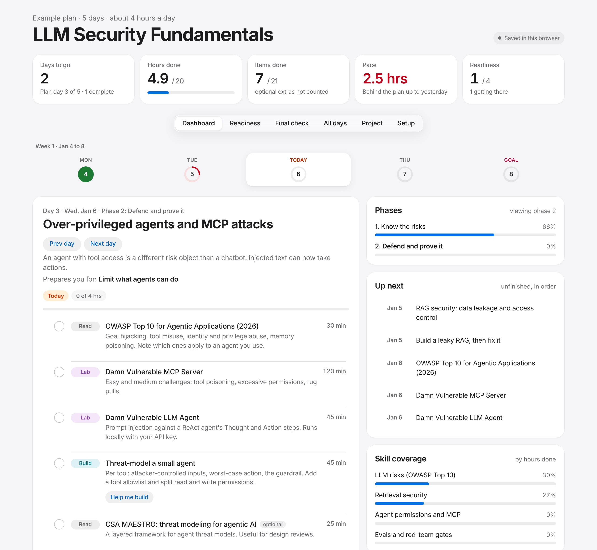
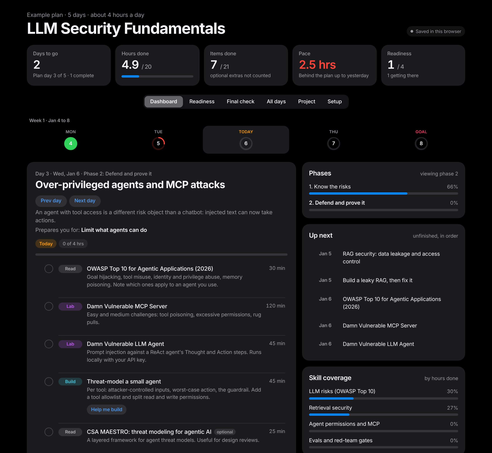
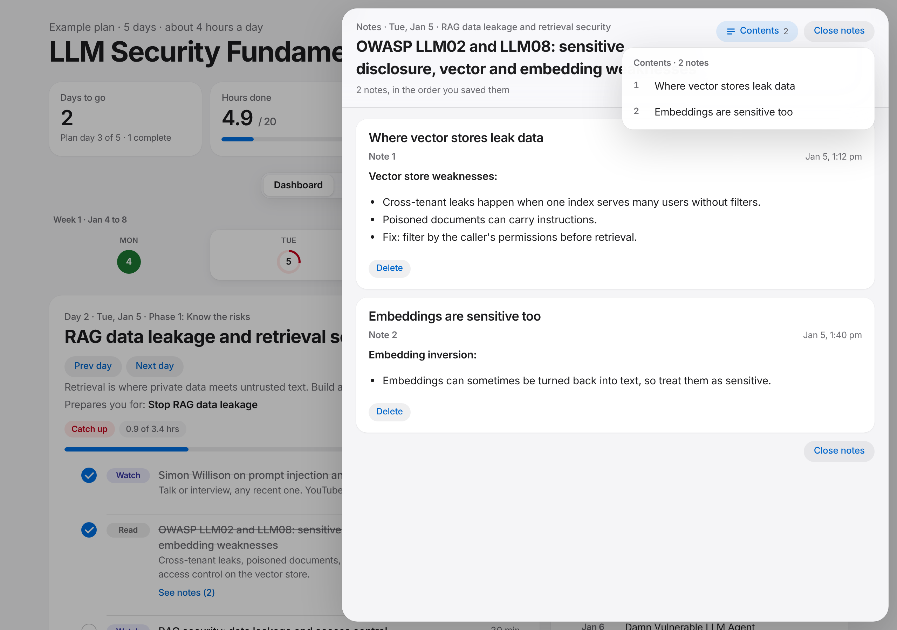
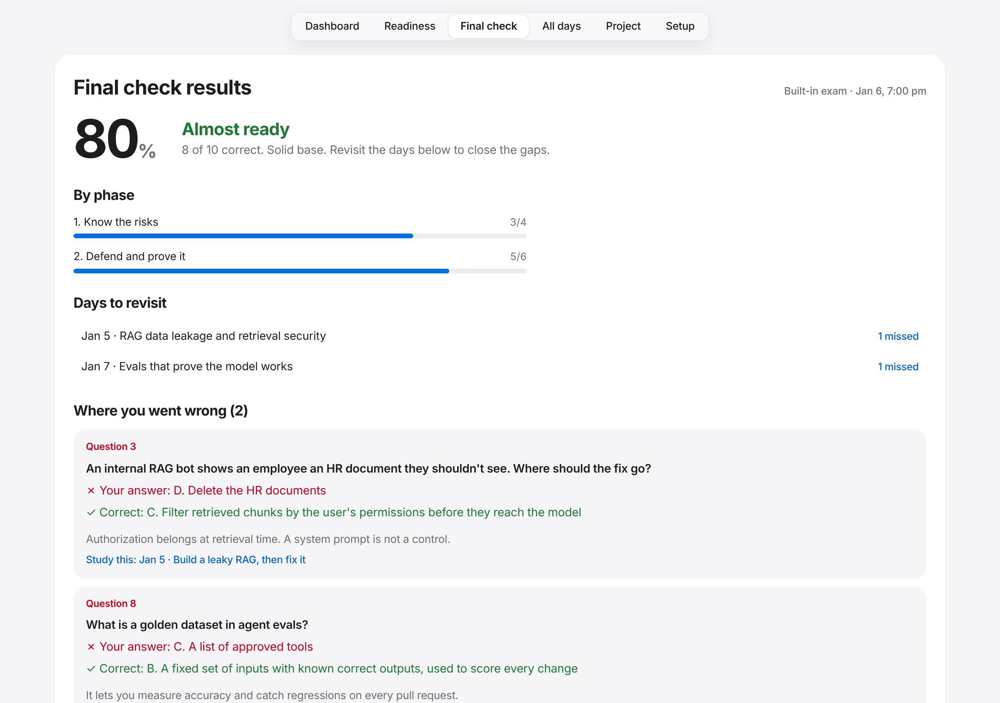
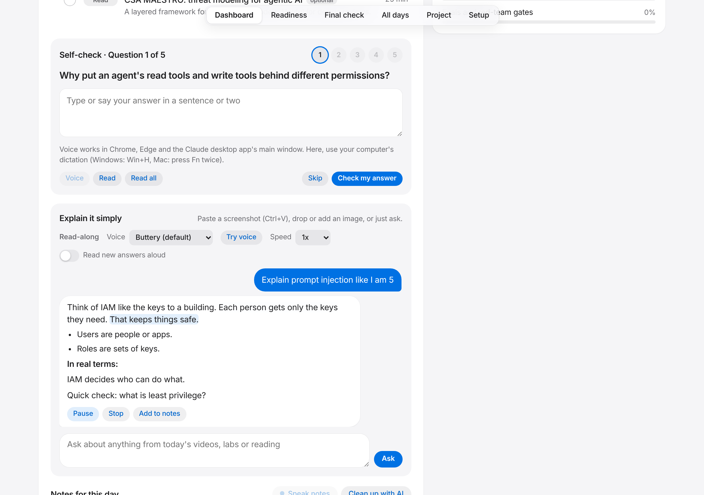
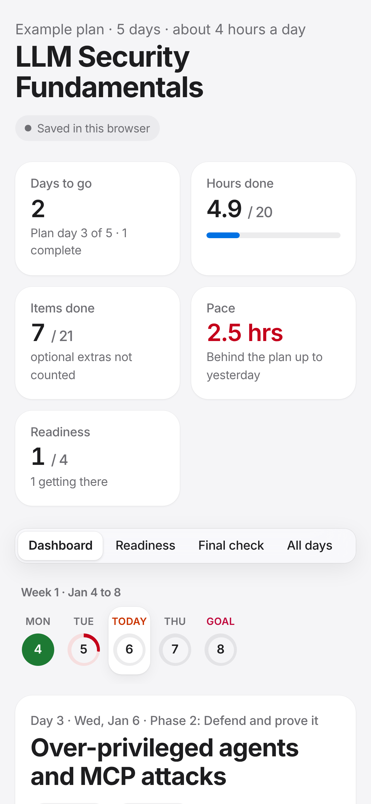

# Study Roadmap

**Turn any certification, job or subject into a day-by-day study plan you'll actually follow.**

Study Roadmap is a skill for Claude. Tell it what you're preparing for, answer a few quick
click-to-choose questions, and Claude researches the topic and builds you a personal roadmap as a
clean, interactive dashboard. You get a daily checklist with verified resources, an AI tutor that
explains anything like you're 5, daily self-checks, voice notes with AI clean-up, step-by-step build
guides, natural read-aloud, and a 50-question final exam that links every miss back to the exact day
to revisit.





## How it works

1. **You ask.** "Help me prepare for CompTIA SecAI+", "Make me a 6-week plan to learn Kubernetes",
   or "Ramp me up for my new job" (then paste the job description).
2. **Claude asks a few questions with clickable choices.** Start date, timeline, hours on weekdays
   and weekends, your level, how you like to learn, whether you want a hands-on project, and whether
   you have study material to upload.
3. **Claude researches.** Official exam objectives or the job description line by line, then video
   and hands-on resources first. Every link is checked, and every objective is covered by at least
   one day.
4. **You get your dashboard.** One plan file goes into a ready-made, tested template, so every
   roadmap is equally polished. It's published as a private page in your Claude account that saves
   your progress across devices.

## What's in the dashboard

| | |
| --- | --- |
| **Daily plan** | A calendar with a progress ring for every day, Reminders-style checklists, minutes per item, and links that open in a new tab |
| **Self-check** | 5 short questions a day. Type or speak an answer and get a quick verdict: what's right, what's wrong, what you missed |
| **Explain it simply** | Ask anything or paste a screenshot from a video or lab. Answers come like you're 5, then in real terms, then a quick check |
| **Read-along** | Natural Claude voices with sentence highlighting, speed control and a Try voice button |
| **Notes** | Type, dictate or paste screenshots. Clean up with AI fixes misheard words and lists every change. Every saved note gets a heading, and a Contents menu jumps between them |
| **Help me build** | A step-by-step teacher for every hands-on build: what you're doing, why, the exact commands, how to check it worked, and what to do if it breaks |
| **Readiness** | Every exam objective or job requirement, what it looks like in practice, the proof you'll have, and a self-rating |
| **Final check** | A 50-question exam with a readiness mark, scores by phase, and a "Study this" link for every miss |
| **Design** | Calm, Apple-inspired design with light and dark mode, phone layouts, keyboard support and reduced-motion support |

<table>
<tr>
<td></td>
<td></td>
</tr>
<tr>
<td></td>
<td></td>
</tr>
</table>

## Install

### Claude app (claude.ai or the desktop app)

1. Download [`dist/study-roadmap.zip`](dist/study-roadmap.zip) from this repository. Don't unzip it.
2. In Claude, open **Customize > Skills**, add a skill, and upload the ZIP.
3. Turn the skill on, and make sure code execution is turned on in your Claude settings.

### Claude Code

```bash
git clone https://github.com/Kishore0924/study-roadmap.git ~/.claude/skills/study-roadmap
```

### Other agents (skills CLI)

```bash
npx skills add Kishore0924/study-roadmap
```

## Use it

Just ask:

- "Help me prepare for the AWS Certified Security Specialty exam."
- "I start a new job as a cloud engineer in 4 weeks. Here's the job description."
- "Make me a 30-day plan to learn Python for data analysis, 1 hour a day."

Claude asks its questions, researches, and gives you the dashboard link. Ask it to change anything
later ("move everything back a week", "add more labs") and it updates the same page without losing
your progress.

## Good to know

- The interactive dashboard needs a Claude app that can publish Artifact pages. Elsewhere you get a
  single HTML file: the checklist, calendar, readiness and Final check work in your browser, but the
  Claude-powered features are hidden.
- Claude features use your own Claude usage and ask permission the first time.
- Voice input and the natural voices work in Chrome, Edge and the Claude desktop app's main window.
  Other browsers fall back to your device's voices.
- Screenshot storage keeps the dashboard shareable only inside your organization.

## How it's built

| Path | What it is |
| --- | --- |
| `SKILL.md` | What Claude follows |
| `assets/dashboard-template.html` | The dashboard: every feature and the design |
| `scripts/build_dashboard.py` | Checks a plan and builds the page |
| `scripts/smoke_test.py` | Clicks through every feature in a headless browser |
| `references/` | Intake questions, research rules, plan schema, publishing |
| `examples/llm-security-5-day.json` | A small, complete example plan |
| `docs/` | Screenshots for this page |
| `dist/study-roadmap.zip` | The skill, ready to upload to Claude |

Claude only ever writes a plan JSON file. `build_dashboard.py` validates it (dates, ids, coverage,
50 well-formed exam questions mapped to real days, no em dashes or arrows) and drops it into the
template. Try it with the example:

```bash
python3 scripts/build_dashboard.py examples/llm-security-5-day.json -o example.html
python3 scripts/smoke_test.py example.html
```

## Credits

Design informed by Apple's [Human Interface Guidelines](https://developer.apple.com/design/human-interface-guidelines/)
and the [apple-design-skill](https://github.com/dickwu/apple-design-skill). This project is not
affiliated with or endorsed by Apple. Linked courses and videos belong to their creators.

Created by Kishore Srinivasan. Released under the [MIT License](LICENSE).
